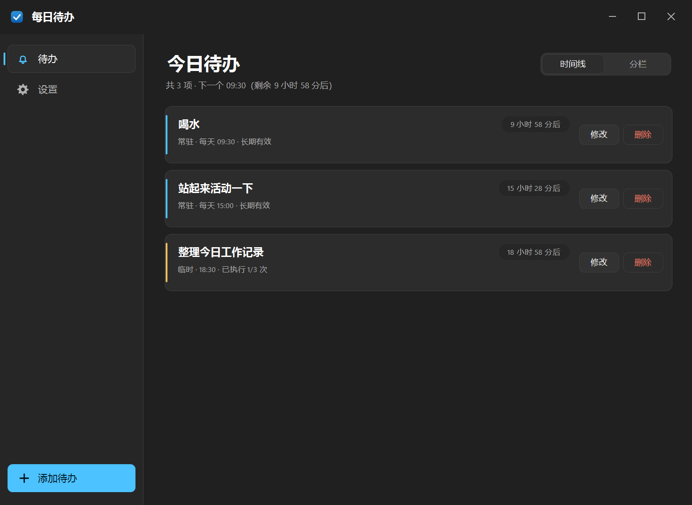
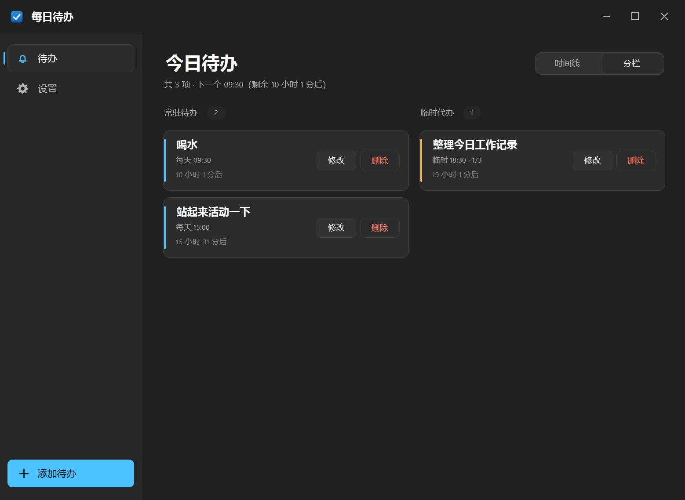

# 每日待办 · DailyTodo

Win11 风格的每日待办 / 定时提醒工具，**Windows 单文件 exe + 安卓 APK 双端**，两端用同一套待办识别码与局域网同步协议互通。

<p align="center">
  
  
</p>

## 下载

| 平台 | 文件 | 说明 |
| --- | --- | --- |
| Windows 10 / 11 | `每日待办-Windows.zip`（见 [Releases](../../releases)） | 解压后双击 `每日待办.exe`，免安装、零运行库依赖 |
| Android 7.0+ | `每日待办-1.3.apk` | 自签名安装包，安装时需允许「安装未知应用」 |

历史版本（1.1 / 1.2 / 1.3）都在 [Releases](../../releases) 里，源码打包见对应 tag。

## 功能一览

- **添加 / 修改 / 删除**：名称、提醒时间（每天）、常驻（生效区间）或临时（执行次数），删除二次确认
- **两个视图**：时间线（按剩余时间排序）、分栏（常驻在左、临时在右）
- **四通道提醒**：系统通知 + 应用内横幅 + 任务栏闪烁 + 提示音，迟到 12 小时内补提醒
- **托盘常驻**：关窗即最小化到托盘，提醒不中断；可开机自启
- **账号 + 局域网同步**：同一邮箱登录的设备在同一网段自动交换待办（较新者胜 + 删除墓碑）
- **待办识别码**：由内容算出的 16 位哈希，用于去重与跨设备「导入待办」
- **安卓端专有**：灵动岛式悬浮提醒（小岛 → 大岛 → 确认页）、确认页可「完成本次」或「延后 5/10/15 分钟」、系统返回手势改为应用内返回

## 技术栈

- Windows：C++17 + Win32 + GDI+ 全自绘界面，MinGW 静态链接，**单个 exe**
- Android：纯 Java（无第三方依赖），用 `aapt2 + d8 + apksigner` 脚本打包
- 同步：UDP 48710 发现 + TCP 48711 交换，SHA-256 口令摘要鉴权，LWW 合并 + 墓碑删除

## 目录结构

```
src/            Windows 源码（main.cpp 界面 / core.cpp 数据与调度 / ui.cpp 绘制 / account.cpp 账号与同步）
res/            图标、manifest、资源脚本
android/        安卓工程（src/com/dailytodo/app、res、AndroidManifest.xml、build_apk.py）
preview/        界面截图
build.cmd       Windows 一键构建（windres + g++）
```

## 从源码构建

```bat
:: Windows（需要 MinGW-w64 g++）
build.cmd

:: Android（需要 JDK 17 + Android build-tools，见 android/build_apk.py 顶部路径）
python android\build_apk.py
```

> 本机运行产生的 `tasks_data.txt`、`accounts.txt`、`sync_meta.txt`、`account_session.txt` 都是私有数据，已写进 `.gitignore`，不会进入仓库；首次运行会自动创建。

---

## 使用手册

## 一、界面与功能

### 1. 首页（待办列表）—— 两个视图

右上角「时间线 / 分栏」切换：

| 视图 | 内容 |
| --- | --- |
| 时间线 | 所有待办按「下一次提醒的剩余时间」升序排列，已结束/已完成的排最后并置灰 |
| 分栏 | 左侧「常驻待办」、右侧「临时代办」，各自显示数量角标 |

每张卡片都显示：名称、类型与提醒时间、剩余时间（如「10 小时 2 分后」），以及 **修改** 和 **删除** 两个按钮。
删除是二次确认：点一次变成红色「确认删除」，再点一次才真正删除（4 秒内不点会自动取消）。

窗口是无边框自绘的：拖动标题栏移动窗口，拖动窗口四边/四角缩放（没有系统边框，所以不会出现 Win11 给系统窗口画的那圈描边，深色界面下才不会在失焦时冒出一圈白框）。

### 2. 添加 / 修改待办（同一个页面，只有标题不同）

左下角「+ 添加待办」进入；卡片上的「修改」进入的是同一套界面，标题变为「修改待办」并带出原有内容。

- **待办名称**：文本输入
- **提醒时间（每天）**：时/分步进器（`<` `>` 调整），并提供 08:00 / 12:00 / 18:00 / 21:00 快捷按钮
- **待办类型**：常驻待办 / 临时代办
  - 常驻待办：**生效区间** —— 开始日期 + 结束日期（可勾选「无结束日期（长期有效）」），点日期打开自绘日历
  - 临时代办：**执行次数** —— 每次提醒后计数 +1，全部执行完自动置为「已完成」
- 底部：取消 / 保存

### 3. 设置

- **开机自动启动**（最高优先级）：写入 `HKCU\Software\Microsoft\Windows\CurrentVersion\Run`，值名「每日待办」，命令行 `"<exe 路径>" --autostart`；登录后自动运行，无需管理员权限
- **关闭窗口时最小化到托盘**：默认开启
- **提醒时播放提示音**
- **兼容模式：阻止第三方注入**：见「五、闪退排查」。**只作用于本程序**，不影响其它任何程序；开启后本程序内无法用中文输入法输入待办名称（设置保存在 `HKCU\Software\每日待办` 的 `BlockThirdPartyDll`，重启本程序生效）
- **暂停全部提醒**：临时静音，数据保留
- **数据文件**：显示路径，并可「打开所在文件夹」
- **发送测试通知**：立刻验证提醒通道

---

## 二、提醒机制（只要程序在运行就一定准时）

- 主窗口常驻一个 1 秒定时器；到点后与当前时间比对，**同一分钟内只触发一次**（用 `lastFiredKey = "YYYY-MM-DD HH:MM"` 去重）
- 触发动作（多通道，任一条可用即可提醒到人）：
  1. **系统通知**：托盘气泡（`Shell_NotifyIcon` + `NIF_INFO`），Win11 下显示为通知中心里的系统通知
  2. **应用内横幅**：窗口右下角的提醒卡片，8 秒自动消失 —— 即使系统通知被系统设置关闭也不会漏
  3. **任务栏闪烁**（`FlashWindowEx`）
  4. **提示音**（设置里可关）
- 迟到补提醒：如果启动/唤醒后已经过了提醒时间但在 12 小时内，仍会补一次提醒（标注「补提醒」）
- `--autostart` 参数用于开机自启，行为和正常启动一致

> 如果 Windows 里把通知全局关掉了（`NOC_GLOBAL_SETTING_TOASTS_ENABLED = 0`），系统通知不会弹出，此时靠应用内横幅 + 闪烁 + 提示音提醒。

---

## 三、构建

需要 MinGW-w64（g++ 8.1+ 即可），无需 MSVC/Windows SDK：

```bat
build.cmd
```

内部执行：

```bat
windres -i res\app.rc -o build\app_res.o --input-format=rc --output-format=coff -I res
g++ -std=c++17 -O2 -DUNICODE -D_UNICODE -municode -mwindows ^
    src\main.cpp src\core.cpp src\ui.cpp build\app_res.o ^
    -o 每日待办.exe -static -static-libgcc ^
    -lgdiplus -lole32 -loleaut32 -lshell32 -luser32 -lgdi32 ^
    -lcomctl32 -ladvapi32 -ldwmapi -luxtheme -lshlwapi -lmsimg32 -limm32
```

图标由 `res/make_icon.py`（Pillow）生成 `icon.ico` / `icon.png`；`res/app.manifest` 提供 Common-Controls v6、Per-Monitor V2 DPI 感知、longPathAware。

源码结构：

| 文件 | 职责 |
| --- | --- |
| `src/app.h` | 结构体（Task / Theme / EditForm）、全局状态、外部接口声明 |
| `src/core.cpp` | 数据模型与 TSV 持久化、提醒调度、系统通知、开机自启、主题色板 |
| `src/ui.cpp` | 字体、GDI+ 圆角/文字/矢量图标绘制 |
| `src/main.cpp` | 窗口过程、布局与命中区、列表/编辑/设置三页、自绘日历、托盘 |

---

## 四、说明与已知限制

- 若程序以**低完整性级别**（如被沙箱/受限进程启动）运行，写 `HKCU\...\Run` 会被系统拒绝（`ERROR_ACCESS_DENIED`），此时开关会自动回到关闭状态并弹出提示，详情写入程序目录的 `autostart.log`。正常双击运行（中完整性）不受影响。
- 数据文件请勿在程序运行时手工改动；程序退出前会写盘。
- `_legacy_backup/` 是原始版本（旧的 `每日待办.cpp` / exe / 数据）备份，确认不需要可自行删除。

---

## 五、闪退排查（重要）

### 1. 与「游戏加加」等游戏覆盖层冲突

若系统里装了 **游戏加加（GamePP）/ 类似游戏助手**，它们会把覆盖层 DLL（`GPP64.dll`，位于
`%LOCALAPPDATA%\GamePPSDK\<版本>\`）注入到带窗口的进程里。该 DLL 在本程序中会抛
`0xC0000005` 访问违例并把宿主进程一起带走，表现为**双击后闪退或运行一两分钟后窗口消失、托盘图标消失**。

实测证据（开启诊断日志后抓到的崩溃栈）：
```
[10:03:12.107] ==== start cmdline='' nCmdShow=10
[10:03:14.693] veh code=0xC0000005 addr=... module=C:\Users\<用户>\AppData\Local\GamePPSDK\1.2.1615.625\GPP64.dll
[10:03:14.694] veh code=0xC0000005 addr=... module=C:\Windows\SYSTEM32\ntdll.dll
...（随后 fail-fast 终止）
```
结束游戏加加全部进程后，同一 exe 用 explorer 启动连续运行 3 分钟以上不再崩溃。

处理办法（任选其一）：
1. **退出游戏加加**（托盘右键退出）后再用本程序；需要时再打开。最彻底。
2. 在游戏加加设置里关闭「游戏内覆盖 / 悬浮窗 / 性能监控注入」一类开关。
3. 卸载游戏加加。
4. 打开本程序的 **设置 → 兼容模式：阻止第三方注入**，然后重新打开本程序。

### 2. 兼容模式（阻止第三方注入）—— 只影响本程序

开启后，程序在创建任何窗口之前调用
`SetProcessMitigationPolicy(ProcessSignaturePolicy, MicrosoftSignedOnly)`，
让 Windows **只允许微软签名的 DLL 加载进本进程**，游戏加加 / 各类覆盖层就注入不进来，闪退随之消失。

- **作用范围仅限本进程**：这是"进程级"缓解策略，不是系统设置。浏览器、Office、游戏、以及输入法在其它程序里的中文输入**完全不受影响**。
- **唯一代价**：本程序自己无法使用第三方输入法（搜狗/QQ 等）输入中文，因此在「添加/修改待办」里输入名称会被限制为英文/数字。用粘贴（Ctrl+V）粘贴中文是可以的。
- 设置项保存为注册表 `HKCU\Software\每日待办` 的 DWORD `BlockThirdPartyDll`（1 开 / 0 关），**重新打开本程序后生效**；开关失败会提示「无法修改兼容模式」（一般发生在以低完整性级别运行时）。
- 被挡掉的 DLL 会**静默加载失败**，不会弹出「损坏的映像 / 0xc0000428」这类系统错误框：程序启动第一件事就是调用 `SetErrorMode(SEM_FAILCRITICALERRORS | SEM_NOGPFAULTERRORBOX | SEM_NOOPENFILEERRORBOX)` 关掉硬错误弹窗。
- 如果想彻底关掉，把该开关拨到关闭并重启程序即可，输入法立刻恢复正常。

程序启动后如果检测到已被注入，会在右下角弹出提示条提醒你。

### 3. 需要日志时

把程序目录下新建一个空文件 `debug.on`（或设置环境变量 `TD_DEBUG=1`）再启动，程序会在同目录
写 `startup.log`：启动参数、每次重绘、每分钟调度、以及任何首次异常（含故障模块名）。
排查完删掉 `debug.on` 即恢复静默。

---

## 六、账号与局域网同步

左侧导航第三项「账号」。

- **邮箱注册 / 登录**：邮箱 + 密码（≥6 位）。密码**明文不落盘**，本地只保存
  `SHA256(小写邮箱 + ":" + 密码)` 的 64 位十六进制摘要（见 `accounts.txt`）。
  同一个邮箱+密码在不同设备上算出的摘要相同，它就是局域网内的配对凭据。
- **局域网自动同步**：登录后开启「局域网同步」（默认开）。
  - 发现：UDP **48710** 广播 `DAILYTODO DISCOVER 1`，对端回 `DAILYTODO HERE <实例ID> <TCP端口> <是否登录>`
  - 交换：TCP **48711** 上的极简 HTTP，`POST /sync`，正文是行协议
    `SYNC 1 / EMAIL / PROOF / COUNT n / TASK id|title|kind|hour|minute|start|end|hasEnd|total|done|enabled|updated|deleted|lastFired / END`
  - 合并规则：**按 `updated` 较新者胜**；删除会写墓碑（`sync_meta.txt` 里 `deleted=1`）并传播，
    避免已删除的待办被对端"复活"（Windows 与安卓两端都实现了墓碑）
  - 每 5 秒自动同步一次，也可点「立即同步」；两端界面都会自动刷新
- 相关文件（都在 exe 同目录）：`accounts.txt`、`account_session.txt`（当前登录与同步开关）、`sync_meta.txt`（墓碑表）
- 前提：两台设备在**同一局域网**（同一路由器/同一网段），且防火墙允许本程序访问专用网络。

实测（2026-11-14）：

| 测试 | 方法 | 结果 |
| --- | --- | --- |
| 注册/登录 | UI 输入 `demo@lan.test` / `secret123` | 通过，落盘的是 SHA-256 摘要 |
| 双实例新增同步 | 实例 B 加 `from-app` | 实例 A 5 秒内变「共 4 项」并出现该任务 |
| 删除传播 | 实例 A 删 `from-app` | 实例 B 同步后也变成 3 项，两端 `sync_meta.txt` 都有墓碑 `00a89b060000 … 1` |
| 第三方协议互通 | 用 Python 模拟安卓客户端 `POST /sync`（含新任务） | 返回 `200 OK` + `COUNT 5` 全量快照，新任务被并入 Windows 端列表 |

## 七、安卓版（`每日待办-<版本>.apk`）

同目录下的 `每日待办-1.3.apk` 是与 Windows 版功能对等的安卓客户端，源码在 `android\`。

**安装包命名与归档规则**：产物一律命名为 `每日待办-<版本>.apk`（如 `每日待办-1.1.apk`、`每日待办-1.2.apk`、`每日待办-1.3.apk`），
**每个版本都保留**，只有出现重大 bug 的版本才会被删除/覆盖。

| 安装包 | 大小 | 说明 |
| --- | --- | --- |
| `每日待办-1.1.apk` | 66,345 B | 修复 PendingIntent 崩溃 |
| `每日待办-1.2.apk` | 74,537 B | 去示例数据、灵动岛、确认待办页 |
| `每日待办-1.3.apk` | 78,633 B | 识别码导入、隐藏列表识别码 +「更多选项」复制、应用内返回手势 |

- 包名 `com.dailytodo.app`，版本 1.3（versionCode 4），minSdk 24（Android 7.0+），targetSdk 34
- 功能对齐：两个视图（时间线 / 分栏）、添加/修改（名称、提醒时间、常驻的起止日期、临时的执行次数）、删除二次确认、设置（开机自启 = 开机重排闹钟、提示音、暂停全部提醒、测试通知）、账号（邮箱注册/登录、局域网同步开关、立即同步、退出登录）
- 提醒：`AlarmManager.setExactAndAllowWhileIdle` + 通知渠道 `reminders`，开机后 `BootRcv` 自动重排全部闹钟；建议在系统设置里允许「自启动」并关闭对本应用的电池优化（设置页有「忽略电池优化」入口）
- 局域网同步：与 Windows 完全同一套协议（UDP 48710 发现、TCP 48711 交换、LWW + 墓碑），Android 端同时实现客户端与服务端，所以 Windows 与安卓可以互相拉取

### 重新打包 APK

需要 JDK 17 与 Android build-tools（已解压在 `_build_tools\`）：

```
cd 每日待办\android
python build_apk.py
```

脚本会：`javac` → `aapt2 compile/link` → `d8` → 把 `classes.dex` 塞进 apk → `zipalign` → `apksigner` 签名，
最终产物是 `每日待办\每日待办-<版本>.apk`（版本号取自 `build_apk.py` 顶部的 `VERSION`，自签证书，可直接安装）。

> **签名证书固定**：keystore 是工程里的 `android\dailytodo.keystore`（口令 `dailytodo`），
> 不再每次重新生成，这样新版本可以直接覆盖安装。若换过证书，安装前需先卸载旧版本。

> 打包踩坑：`aapt2` **不支持含中文的路径**，且 `javac` 在工作区之外的 ASCII 目录会报
> `could not create parent directories`。所以脚本会先把工程复制到工作区内的 ASCII 暂存目录
> `E:\GitHub\My-codes\VS Code\tdapk` 再构建，成功后才把 apk 拷回 `每日待办\`。

### 安卓端排查记录

| 现象 | 原因 | 处理 |
| --- | --- | --- |
| 装上后一打开就闪退：`IllegalArgumentException: Targeting S+ (version 31 and above) requires that one of FLAG_IMMUTABLE or FLAG_MUTABLE …` | `Sched.pi()` 创建 `PendingIntent` 时没带可变性标志（Android 12 起强制要求） | 1.1 版已改为 `flags \| FLAG_IMMUTABLE`（`Sched.java:36`），并给 `onCreate` 里的通知渠道/同步/闹钟三处调用加了 try-catch，任何一步出问题都不会再阻断界面启动 |

## 八、当前进度（2026-11-14）

- ✅ Windows 端：全部功能 + 账号 + 局域网同步；**新增/修改/删除三个方向的同步都已实测通过**（删除会写墓碑并传播）
- ✅ 安卓端：源码、清单、图标、打包脚本齐备，APK 已产出并签名（`每日待办.apk` v1.1，v2/v3 签名校验通过）
- ✅ 安卓真机首启崩溃（`PendingIntent` 缺 `FLAG_IMMUTABLE`）已在 1.1 修复
- ✅ 协议互通性：用一个 Python 写的"假安卓客户端"直接对 Windows 端 `POST /sync`，成功拿到全量快照并把自己新增的任务合并进 Windows 端
- 🧹 已清理：`account.cpp` 的 `AccLog`、`main.cpp` 里 `WM_LBUTTONDOWN` 的调试日志、`debug.on` / `startup.log` / `account.log` / `_test2` / 构建暂存目录
- ⏳ 待做：安卓端后续版本要在真机继续验证（闹钟精确性、开机自启、与 Windows 端的双向同步）
- ⚠️ 系统通知：注册表与策略层面的关闭项已修复（通知总开关已为「开」，请勿打扰「关」），但本机
  `ShellExperienceHost.exe` 一启动就报「基于堆栈的缓冲区溢出」，导致系统 toast 不显示；
  程序自身的应用内横幅 / 任务栏闪烁 / 提示音三条通道不受影响


## 九、编码问题记录（2026-11-14）

现象：系统通知里应用名显示成「姣忔棩寰呭姙」，正文却是正常中文。

原因链：
1. `res/app.rc` 的 VERSIONINFO 里中文写成 UTF-8 字节八进制转义（`\346\257\217…`），
   windres 默认按系统 ANSI 代码页（本机 936/GBK）解释 → exe 的
   `FileDescription` / `ProductName` 变成乱码。
2. 托盘程序没有显式 AppUserModelID 时，Windows 会生成
   `NotifyIconGeneratedAumid_<hash>`，**通知里显示的应用名取自 exe 版本资源，并缓存到**
   `HKCU\Software\Classes\AppUserModelId\...\DisplayName`。
3. 于是通知标题一直是那个缓存的乱码，改 exe 也不会自动更新。

修复：
- `res/app.rc` 首行加 `#pragma code_page(65001)`，让 windres 按 UTF-8 解释；现在
  `(Get-Item 每日待办.exe).VersionInfo.FileDescription` 读出来是「每日待办」。
- 程序启动时调用 `SetCurrentProcessExplicitAppUserModelID(L"DailyTodo.App")`，并写入
  `HKCU\Software\Classes\AppUserModelId\DailyTodo.App` 的 `DisplayName` = 每日待办、
  `IconUri` = exe 路径（`InitAppIdentity()`，见 `src/main.cpp`）。这样不再依赖自动生成的
  AUMID，通知里的名字与通知设置页里的条目都固定为「每日待办」。
- 删除旧的缓存键 `NotifyIconGeneratedAumid_14674143851191404219`。

正文一直是正常中文，因为它来自运行时构造的宽字符字符串，不经过资源编译。

## 十、待办识别码（2026-11-14）

每条待办都有一个**由内容算出来的识别码**，界面上显示为 `#xxxxxxxx`（卡片上 8 位，修改页 16 位）。

算法（两端必须逐字节一致）：

```
常驻：SHA-256( "P|" + 标题 + "|HH:MM|" + 开始日期 + "|" + (结束日期 或 "-") )
临时：SHA-256( "T|" + 标题 + "|HH:MM|" + 执行次数 )
取前 16 位十六进制
```

- 标题会做规范化：去首尾空白、连续空白压成一个空格。
- `已完成次数 / 是否启用 / 上次提醒时间` **不参与**计算——这些是状态，不是身份，否则提醒一次识别码就变了。
- 实现：Windows 端 `core.cpp` 的 `ComputeTaskCode()`，安卓端 `Sync.taskCode()`。

**同步时按识别码去重**：如果远端推来的一条待办，其识别码与本地已有某条相同（哪怕 id 不同），就跳过、不重复添加；服务端合并快照时同样跳过。这样两台设备各自新建了"一模一样的待办"（比如都加了"喝水 09:30"），同步后仍然只有一条。

手工新增时也做了同样的检查：填完保存若识别码已存在，会提示"这条待办已经存在（#xxxxxxxx），已跳过重复添加"。

## 十一、安卓 1.2 更新（2026-11-20）

### 1. 去掉了「空列表自动塞三条示例」

老版本在 `MainActivity.onCreate` 里有 `if (S.isEmpty(this)) seed();`，所以只要把待办删干净，
下次启动又冒出「喝水 / 站起来活动一下 / 整理今日工作记录」三条。1.2 已删除该调用与 `seed()`、`mkSample()`，
空列表只显示「还没有待办 / 点下面的「添加待办」创建第一条」。

### 2. 到点提醒的灵动岛（小岛 → 大岛 → 确认页）

到点时屏幕顶部浮出小岛 `✓ 有待办要完成`；点一下展开成大岛，显示待办名称（超过 12 个字用「…」截断）
和一行说明（`常驻待办 · 每天 09:30` / `临时代办 · 18:30 · 已完成 2/3`）；再点一下打开应用并**直达「确认待办」页**：

- 卡片显示名称、类型、时间、识别码、上次提醒时间
- 「完成本次」：常驻记为已提醒，临时任务执行次数 +1（满次数自动完成），并重排下一天的提醒
- 「延后 5 分钟 / 延后 10 分钟 / 延后 15 分钟」：单独挂一个 `DELAY` 闹钟，到点再提醒一次；
  每日固定提醒的闹钟不受影响（延后只影响这一次）

实现分两层，取哪层由系统能力决定：

| 层 | 触发条件 | 说明 |
| --- | --- | --- |
| 自绘悬浮岛（`Island.java`） | 需要「显示在其他应用的上层」权限 | `WindowManager` + `TYPE_APPLICATION_OVERLAY`，顶部居中的圆角胶囊；小岛 25 秒、大岛 60 秒后自动收起；点击进应用后自动隐藏 |
| 系统超级岛（`miui.focus.param`） | 需要小米给应用开通「焦点通知」白名单 | 通知里带上 `miui.focus.param` / `miui.focus.pics`，系统支持时自动升级成原生超级岛 |

> **权限怎么开**：设置页 →「灵动岛（悬浮提醒）」→「悬浮窗权限」，跳到「设置 → 显示在其他应用的上层 →
> 每日待办」，打开「允许显示在其他应用的上层」。用 `adb shell appops set com.dailytodo.app SYSTEM_ALERT_WINDOW allow`
> 在小米澎湃 OS 上是**无效**的（系统会忽略，必须以设置页开关为准）。

> **为什么系统超级岛没出来**：`miui.focus.param` 参数已被系统接受（`dumpsys notification` 里能看到
> `focusType=PARAMS`），但 `settings get secure focus_notifs` 一直是 `[]`，用 `settings put` 写进去也会立刻被系统改回。
> 按官方 Q&A（<https://dev.mi.com/xiaomihyperos/documentation/detail?pId=2146>），焦点通知权限要向小米申请：
> 发邮件到 `mipush-permission@xiaomi.com`，主题「【申请开通小米焦点通知使用权限】-yymmdd-APP 名称」，附包名、channel、场景说明，
> 平台配置完成后才会显示原生超级岛。在此之前由自绘悬浮岛顶上，两者可以同时保留。

### 3. 版本与构建

- `AndroidManifest.xml`：`versionCode=3` / `versionName=1.2`，`MainActivity` 加 `singleTop`（点岛复用同一个实例）
- `build_apk.py` 顶部 `VERSION = "1.2"`，产物 `每日待办-1.2.apk`；签名仍用 `android\dailytodo.keystore`（口令 `dailytodo`）

## 十二、识别码导入（1.3 / Windows 同步实现，2026-11-20）

### 1. 用法

1. 在 A 设备上「修改待办 → 更多选项 → 复制」，把这个待办的 16 位识别码复制下来；
2. 在 B 设备的「添加待办」页顶部，把识别码粘进输入框，点「导入」；
3. B 设备会先在本地找：已有同码 → 提示「已有相同待办：「xxx」（#短码），无需重复导入」；
   本地没有就通过局域网问同账号的其它设备，找到后按新 id 落库、重排提醒，并提示「已导入「xxx」」；
   都找不到 → 提示「没找到这个识别码对应的待办：请确认另一台设备在线、已登录同一账号并开启局域网同步」。

识别码是内容的 SHA-256 前 16 位，无法反推出待办，所以**必须有一台设备确实存着这条待办**才能导入。

### 2. Windows 端的形态

Windows 没有粘贴框入口，改成读**剪贴板**：待办页左栏「＋ 添加待办」上方的「导入识别码」按钮，
点一下就把剪贴板里的识别码拿去查（同样先查本地、再查局域网同账号设备）。

- `src\account.h` 新增 `AccountQueryTaskByCode(code, out)`（只读，不合并、不改本地）
- `src\main.cpp` 新增 `H_IMPORT` 热区、按钮绘制与 `DoImportFromClipboard()`

### 3. 安卓端的形态

- `Sync.findByCode()`：先查本机 `Store.loadTasks`，再 `discover()` 广播、对每个 peer `POST /sync` 拉快照按码匹配
- `MainActivity.doImport()/afterImport()`：长度校验（≥8 位）、本地去重、后台线程查询、导入后 `Sched.scheduleAll`
- 导入行只在「添加待办」页显示，修改页不显示（避免误把别的待办插进来）

### 4. 与墓碑的相互影响（注意）

删除是**按识别码传播**的：如果 B 设备删掉了某条待办，A 设备上识别码相同的那条也会被同步删除。
实测时踩过一次：手机里 1.1 版遗留的三条示例待办被删后留下的墓碑，把电脑上同内容的
「喝水 / 站起来活动一下 / 整理今日工作记录」一起删了。恢复办法：停掉程序，用新 id 把这三条重新写回
`tasks_data.txt`，并在 `sync_meta.txt` 里给同 id 写 `deleted=0` 与更新的时间戳（较新者胜），重启即可。

